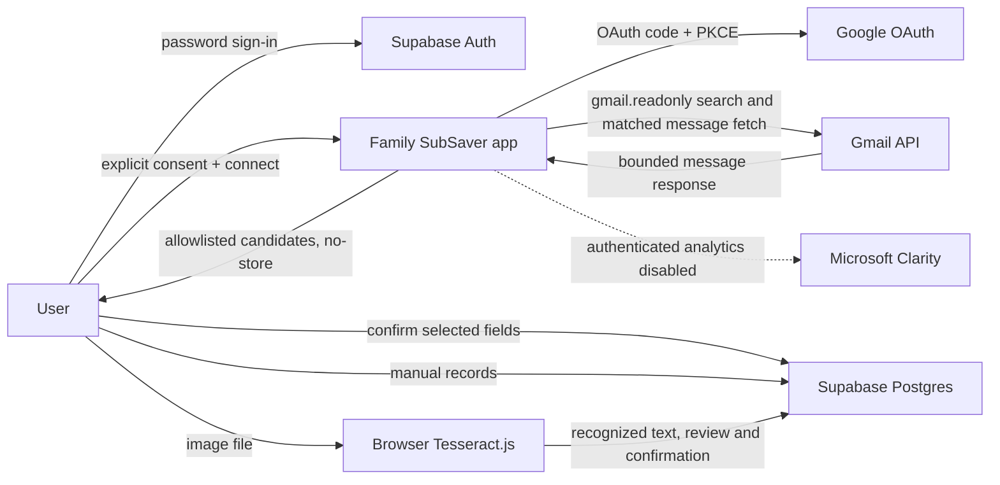

# Gmail data flow and release checklist

Status: development controls are being implemented; this document is not a
Google approval, legal opinion, security assessment, or proof of deployment
configuration. Keep Gmail disabled or allowlisted for genuine testing until
the owner has verified each release gate.

## Data flow and processor inventory

| Provider or component | Data in the current design | Retention / verification status |
|---|---|---|
| Google OAuth and Gmail API | OAuth code, Gmail read-only access token, mailbox search results, matched message content, Gmail profile address | Token is encrypted in a short-lived HttpOnly cookie; raw message content is intended for transient server parsing. Google-side retention and the exact deployed token behavior require live verification. |
| Supabase Auth | App email, password verifier, auth tokens, account metadata | Auth service/provider retention and deletion propagation need to be checked against the selected Supabase plan and policy. |
| Supabase Postgres | Confirmed subscriptions, user/household records, scan quota, Gmail consent version/timestamps, Gmail source type and connection reference | App tables have RLS migrations. Provider backups, PITR, restore behavior, and deletion expiry are not established by this repository. |
| Vercel or configured hosting | Requests, responses, runtime errors, deployment configuration and environment secrets | Hosting logs, traces, CDN behavior, retention, access, and body/header scrubbing have not been verified here. Gmail routes return `Cache-Control: no-store`; confirm deployed CDN and logs do not retain sensitive content. |
| Supabase email delivery | Account-confirmation and recovery messages | Delivery provider, message content, and retention depend on Supabase configuration; verify before public launch. |
| Browser Tesseract.js and language data | User-selected screenshots and OCR result | Image recognition runs in the browser. Tesseract.js may download worker/language assets; verify network requests and pin/self-host assets before making a “device only” network claim. |
| Microsoft Clarity | No authenticated-route events by design | The root layout does not mount Clarity. Verify this remains true in production and remove any external script injected by hosting or extensions. |

This inventory is incomplete until the deployment owner confirms actual hosting,
email delivery, logging, backup, CDN, OCR asset, and operational monitoring
providers and their retention/access settings.

## Implemented controls and known gaps

| Control area | Repository control | Remaining evidence or limitation |
|---|---|---|
| Release mode | Server-only `GMAIL_MODE`; default disabled; test mode checks Supabase user UUID allowlist; public mode requires multiple owner-set gates | Environment flags can be misconfigured. Verify production values and retain documentary evidence; flags do not themselves prove Google verification or assessment. |
| Consent | Versioned consent is written to a user-owned table and checked before connection/callback/scan; consent can be withdrawn | Requires applying migration `20261021000300_gmail_consent.sql` in every environment. Validate consent text, event recording, and error handling against the deployed version. |
| OAuth | Single Gmail read-only scope, random state, PKCE S256, exact callback origin, app-user binding, no offline access | A real Google OAuth test is still required. This repository does not establish provider verification status or token revocation success. |
| Scan bounds | Three server-defined query lanes, 30/45-day choice, spam/trash exclusion, unique-message cap, per-user UTC-day quota | Validate all lanes against current Gmail API semantics, pagination, adversarial dates, concurrent scans, and provider rate limits. |
| Parsing | Bounded response size, MIME part/depth/text limits, attachment-part exclusion, deterministic parsing, no hosted LLM call | Confirm no related parser, logging, trace, cache, or error-reporting path captures raw content. HTML is treated as text, not rendered. |
| Review and persistence | Candidate response omits full headers, subject, message ID, order ID, mandate ID, and card suffix; save requires user confirmation; confirmed records carry Gmail provenance | Verify only selected fields reach Postgres and that all related recommendation/export paths preserve origin and private ownership. Existing older imports may not have reliable source tags. |
| Disconnect and deletion | Google revocation attempted; local Gmail cookie cleared; consent withdrawal and Gmail-tagged record deletion are distinct; account deletion requires recent authentication and cascades user rows | Apply and test migration; test stale cookies, revoke failures, data deletion, backups/restores, and account deletion. Revocation failure does not prove Google has stopped access. |
| Analytics | Clarity component is not mounted in the root layout | Check deployed HTML, scripts, network requests, service workers, CDN caching, and any injected analytics. |
| Manual and screenshot paths | Manual import remains separate; OCR uses browser-side Tesseract.js | Verify screenshot bytes are not sent in network traffic and OCR worker/language asset requests are understood. |

## Threat model and source-to-control checklist

| Threat | Required control | Test evidence to retain |
|---|---|---|
| OAuth CSRF, replay, session swap, malicious redirect | One-time state, PKCE, exact callback origin, authenticated user binding, short expiry | Mismatched/replayed state, changed app user, expired flow, and host-header test cases fail without exchanging a code. |
| Gmail overreach or public-access bypass | Disabled-by-default server gate, tester allowlist, exact scope, consent check on server routes | Direct API tests without consent/allowlist are denied; production configuration review shows disabled/test only until approvals are documented. |
| Quota bypass through parallel requests/devices | Atomic database quota function, per-user UTC day | Concurrent and multi-session tests never exceed five successful live scans per user/day. |
| Unrelated mail or malicious MIME | Search templates, date recheck, bounded body parsing, no thread/attachment fetching, no remote URL loads | Synthetic unrelated, oversized, deeply nested, attachment, HTML-only, and out-of-window fixtures are excluded or bounded. |
| Raw email leakage | Response allowlist, no-store, content-free logs, no analytics/AI route | Synthetic canary does not appear in browser response beyond approved structured fields, DB, logs, traces, cache, analytics, or AI tools. |
| Cross-account or household access | Supabase RLS, authenticated user filters, private imports | Direct PostgREST/API tests for another user and aggregate inference are denied. |
| Token theft or stale access after disconnect | Encrypted HttpOnly cookie, short expiry, revocation, fail-closed scan | Inspect cookie attributes and test expired/invalid/revoked token and stale-cookie flows. |
| Accidental deletion or incomplete erasure | Separate consent withdrawal, Gmail import deletion, account deletion; explicit confirmation and recent password auth | Verify tagged Gmail rows and dependent data deletion; test restoration against provider backup retention and deletion tombstones. |
| Analytics or hosted-AI disclosure | No Clarity on private routes; no hosted LLM in Gmail pipeline | Inspect network traffic, dependencies, logs, and deployed scripts; use synthetic fixtures only. |

The repository does not currently claim that a Google security review, legal
review, provider retention review, production deployment review, or restore test
has been completed.

## Incident runbook

The owner must assign a named incident lead and an alternate before any Gmail
pilot that handles real inbox data. Keep a current, private contact list and
provider escalation details outside this repository.

1. Disable Gmail immediately by setting `GMAIL_MODE=disabled` and redeploying.
   Confirm the server denies status, OAuth initiation, callback completion, and
   live scan requests. Keep manual entry and screenshot OCR available.
2. Preserve only content-free evidence: time, deployment ID, affected opaque
   account identifiers, scan counts, response status, and error codes. Do not
   copy message bodies, OAuth codes, cookies, or tokens into tickets or logs.
3. Rotate compromised OAuth/session secrets and hosting credentials; invalidate
   app sessions and revoke affected Google grants where possible. Record any
   revocation failure and tell affected users how to remove access in Google
   Account settings.
4. Determine which systems/providers were involved, restrict access, and assess
   whether Google user data may have been accessed or disclosed. Follow current
   Google Workspace API user-data incident reporting instructions, including
   `security@google.com` where applicable, and coordinate any public statement
   with Google before publishing.
5. Have qualified counsel assess applicable user, regulator, and contractual
   notification duties and timelines. Do not infer a legal deadline from this
   runbook.
6. Re-enable Gmail only after the incident lead and owner document containment,
   remediation, tested controls, and explicit release approval.

## Public Gmail launch checklist

Keep `GMAIL_MODE=disabled` or an allowlisted `test` until the owner records
evidence for all applicable items:

- [ ] The proposed Gmail use is accurately described to Google and accepted for
  the applicable permitted-use/verification process.
- [ ] OAuth branding, domain and restricted-scope verification requirements are
  complete, or a confirmed applicable exception is documented.
- [ ] The security assessment required by Google is completed at the actual
  assigned scope/tier; renewal owner and due date are recorded.
- [ ] Privacy policy, in-product disclosures, consent version, code behavior,
  processors, retention and deletion behavior agree.
- [ ] RLS, API authorization, OAuth lifecycle, quota, parser bounds, log/cache
  controls, revocation, deletion and restore tests pass in the deployment.
- [ ] Hosting, database, email, logging, CDN, OCR asset, and backup contracts and
  actual retention settings are inventoried.
- [ ] Qualified security and India privacy/legal reviews are dated; do not
  claim DPDP compliance based on code changes alone.
- [ ] Incident lead and alternate are named, and the response runbook is tested.
- [ ] The account owner explicitly approves remaining risks and public release.

Manual entry and local screenshot OCR do not depend on this Gmail launch gate.
